# Симулятор Доступності Вад Зору (Accessibility Simulator)

Цей Python-інструмент призначений для аналізу веб-доступності. Він автоматично робить скріншот вказаного веб-сайту, симулює різні вади зору (катаракта, дальтонізм, глаукома тощо) та оцінює, наскільки читабельним залишається текст після цих спотворень, використовуючи технологію OCR (Tesseract).

## 🌟 Основні Можливості

* **Автоматизація:** Використовує Selenium (headless Chrome) для захоплення скріншота всієї веб-сторінки з областю перегляду 2560×1440.
* **Широкий спектр симуляцій** (15 пресетів у звичайному прогоні, див. таблицю нижче):
    * **Гострота зору та помутніння кришталика:** зниження гостроти (20/40, 20/100), катаракта (20/40, 20/100).
    * **Контрастна чутливість:** втрата контрасту (log CS 1.20).
    * **Порушення кольоросприйняття:** Протанопія, Дейтеранопія, Тританопія (Brettel, Viénot & Mollon, 1997), Протаномалія (Machado et al., 2009), Ахроматопсія.
    * **Втрата поля зору:** Центральна скотома (AMD), Тунельний зір (Глаукома).
    * **Інші вади:** Метаморфопсія (викривлення), "Мушки" (Діабетична ретинопатія).
* **Модель спостерігача:** кожна симуляція (і сам еталон) проходить через модель нормального зору з CSF (Peli, 1990; Lesmes et al., 2010) за геометрією перегляду (відстань, PPI, DPR).
* **Прогін по шкалі тяжкості (`--sweep`):** криві ILR(тяжкість) для кожної вади, поріг початку деградації та точка руйнування, клінічний зміст значень.
* **Аналіз Читабельності (OCR):** Використовує Tesseract OCR для порівняння тексту на оригіналі та на симуляціях.
* **Метрика ILR (Information Loss Ratio):** `ILR = |W_base \ W_sim| / |W_base|` — частка унікальних слів оригіналу, які OCR не зміг розпізнати після симуляції.
* **Візуалізація:** Зелені рамки — слова, що збереглися; помаранчеві — втрачені слова (на позиціях з оригіналу); червоні — артефакти (хибно розпізнані слова).
* **CI/CD:** Поріг якості `--max-ilr` завершує програму з кодом 1, якщо ILR будь-якої симуляції перевищує заданий відсоток.

## 📸 Галерея результатів

Знімки зроблено звичайним прогоном на головній сторінці української Вікіпедії у форматі для документів (1920×1080, лише перший екран):

```bash
python main.py --viewport 1920x1080 --viewport-only
```

Рамки на знімках показують результат OCR: 🟩 слово збігається з оригіналом, 🟧 слово втрачено, 🟥 нове слово-артефакт (помилка розпізнавання).

### 📊 Зведена таблиця
**Файл:** `screenshot_report_readability.png` — для кожного пресету: скільки слів розпізнано, збіг з оригіналом, ILR, артефакти і час.

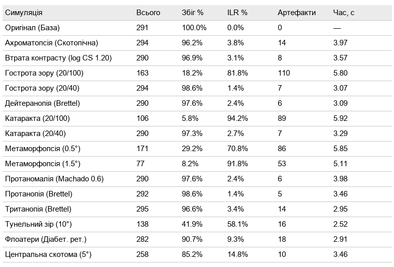

### 🖼️ Оригінал
**Файл:** `screenshot_original.png` — еталон після фільтра нормального спостерігача.

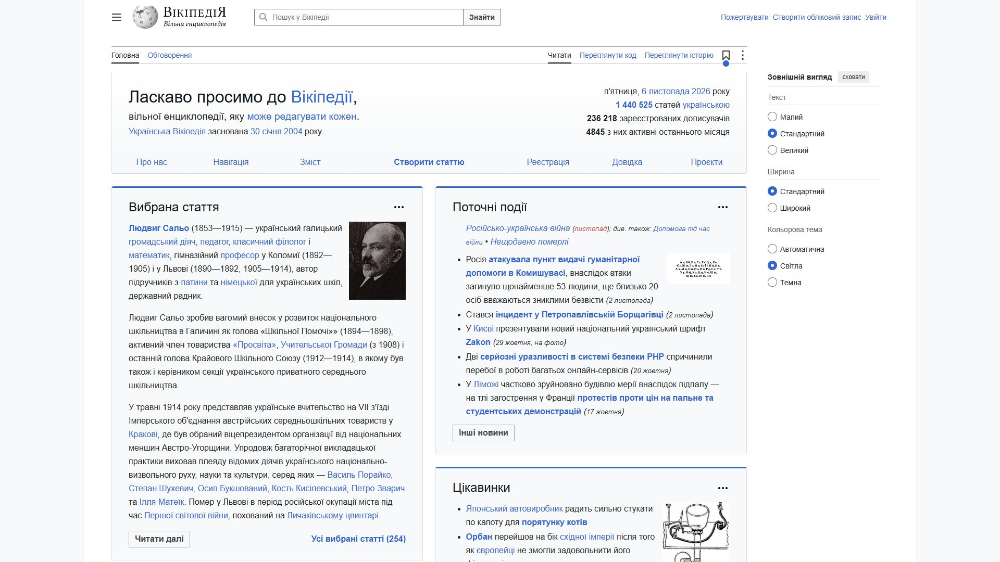

---

### 👓 Гострота зору і катаракта
Розмиття моделюється через контрастну чутливість спостерігача; катаракта додає пожовтіння кришталика й засвітку.

| Гострота зору (20/40) | Гострота зору (20/100) |
|:---:|:---:|
| 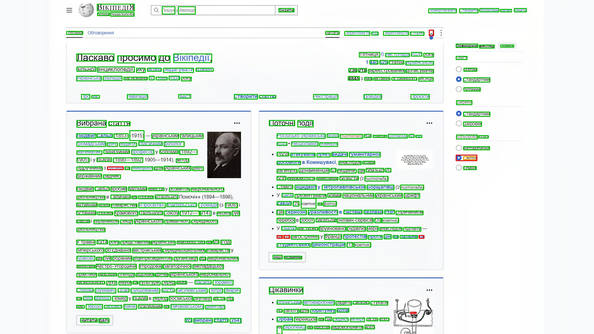 | 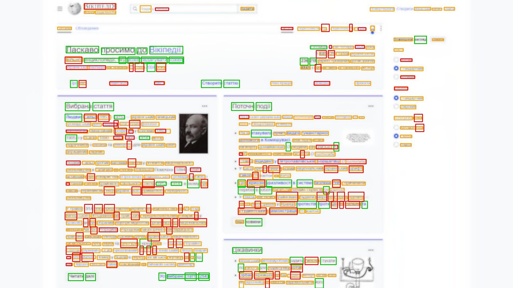 |
| *Легке зниження: текст ще читається.* | *Дрібний текст зникає повністю.* |

| Катаракта (20/40) | Катаракта (20/100) |
|:---:|:---:|
| 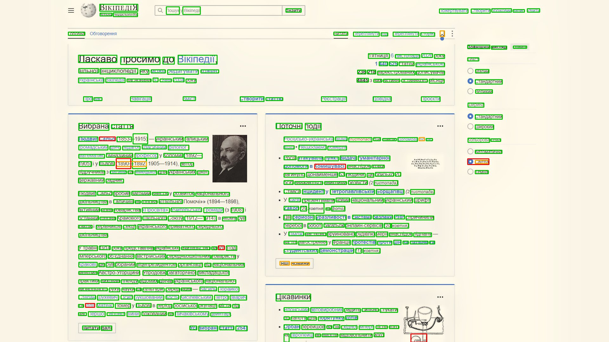 | 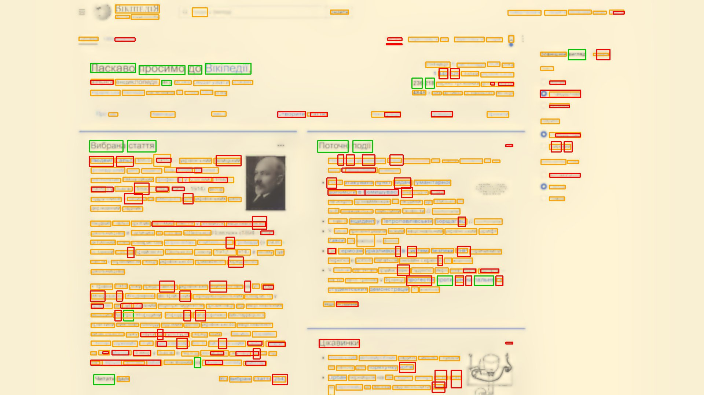 |
| *Пожовтіння та легка засвітка.* | *Розмиття разом зі зниженням контрасту.* |

| Втрата контрасту (log CS 1.20) | Флоатери (Діабет. рет.) |
|:---:|:---:|
| 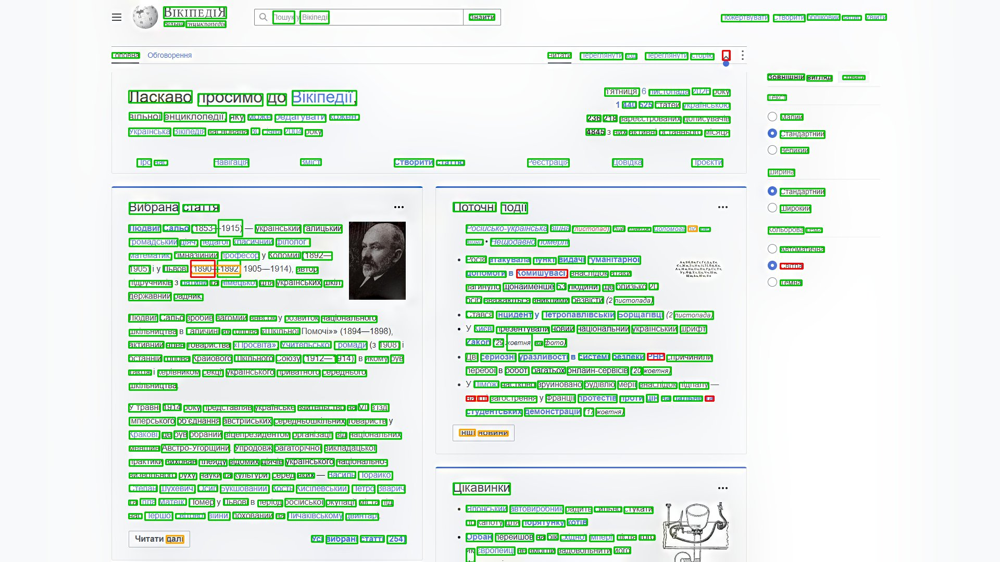 | 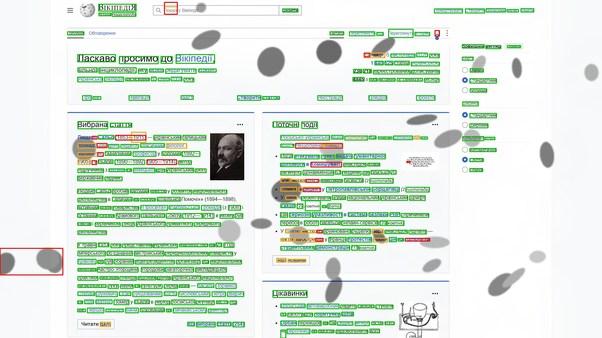 |
| *Висококонтрастний текст майже не страждає.* | *Темні плями перекривають частину тексту.* |

---

### 🌑 Обмеження поля зору
Оцінка за одну фіксацію в центрі екрана (див. «Обмеження»).

| Центральна скотома (5°) | Тунельний зір (10°) |
|:---:|:---:|
| 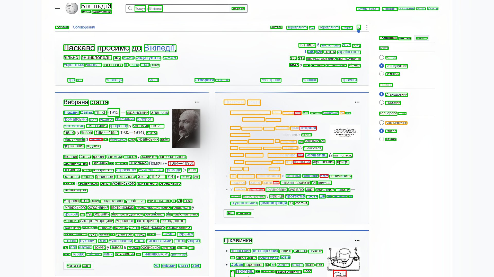 | 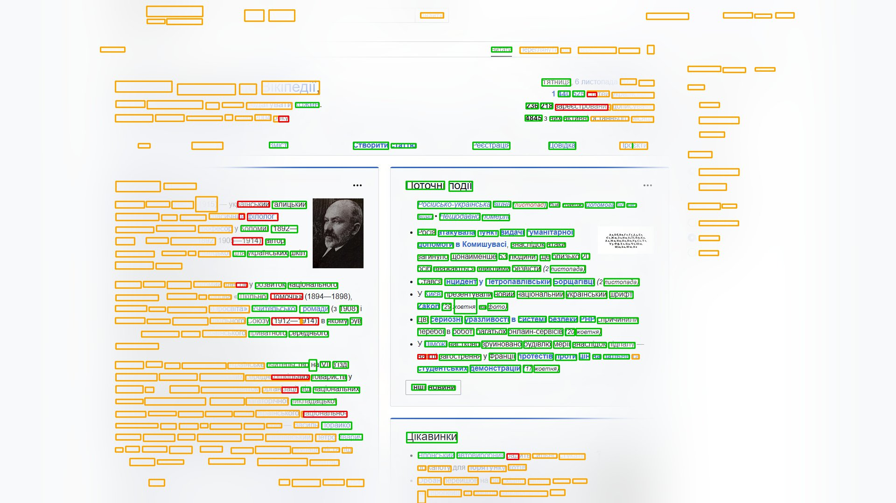 |
| *Втрачено центр поля зору.* | *Залишається лише центральні 10°.* |

---

### 〰️ Метаморфопсія

| Метаморфопсія (0.5°) | Метаморфопсія (1.5°) |
|:---:|:---:|
| 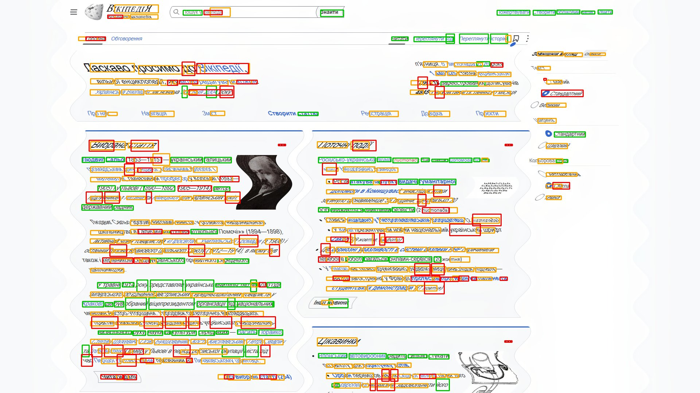 | 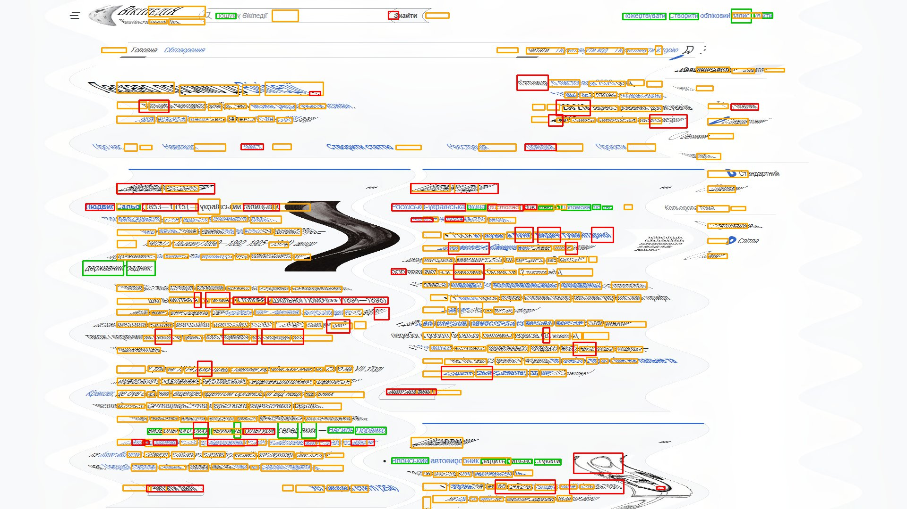 |
| *Хвилеподібне викривлення рядків.* | *Сильне спотворення геометрії.* |

---

### 🎨 Порушення кольоросприйняття

| Протанопія (Brettel) | Дейтеранопія (Brettel) |
|:---:|:---:|
| 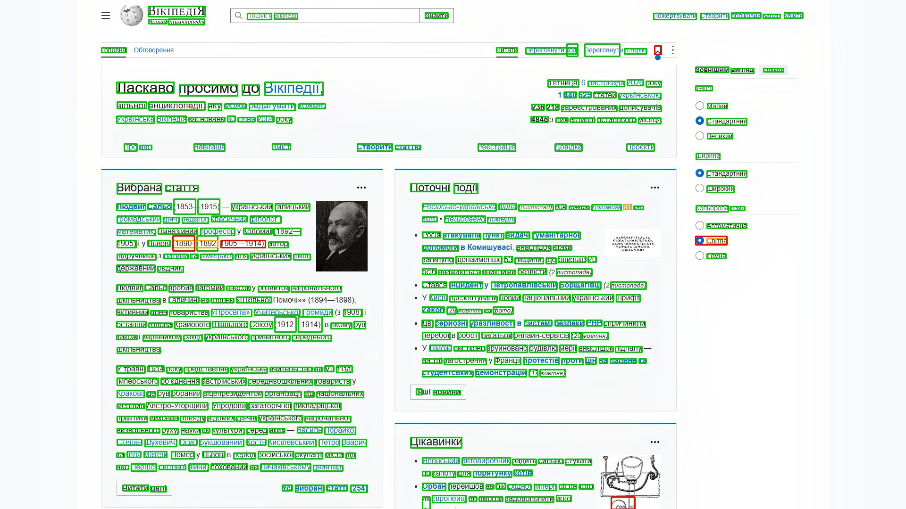 | 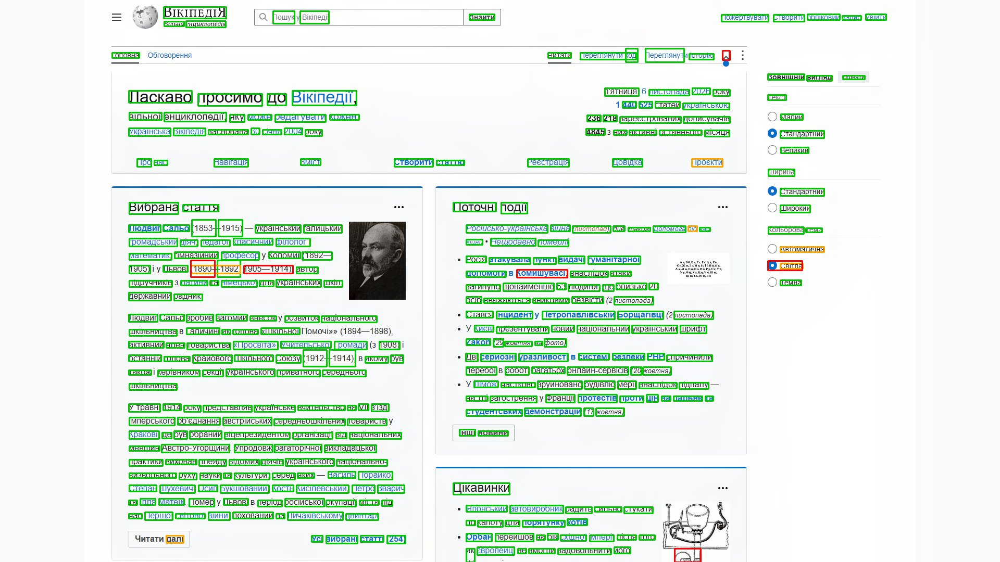 |
| *Відсутні L-колбочки (червоний).* | *Відсутні M-колбочки (зелений).* |

| Тританопія (Brettel) | Протаномалія (Machado 0.6) |
|:---:|:---:|
| 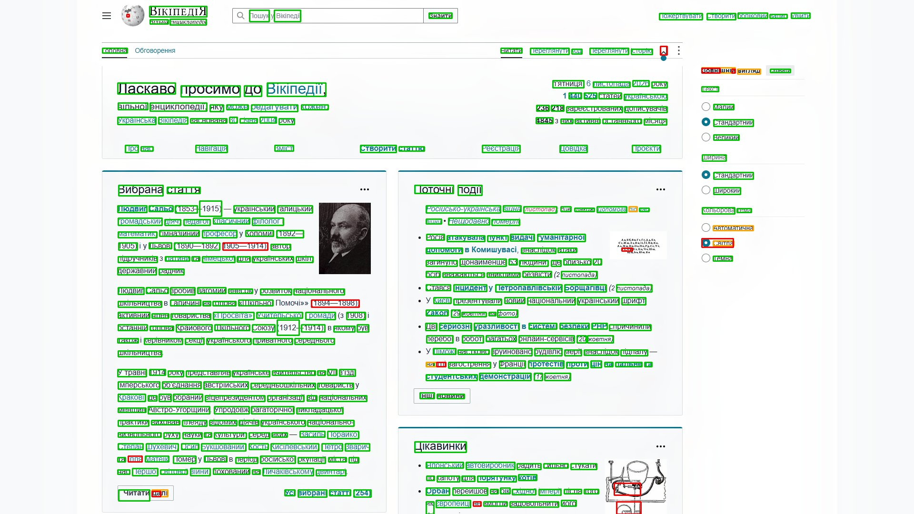 | 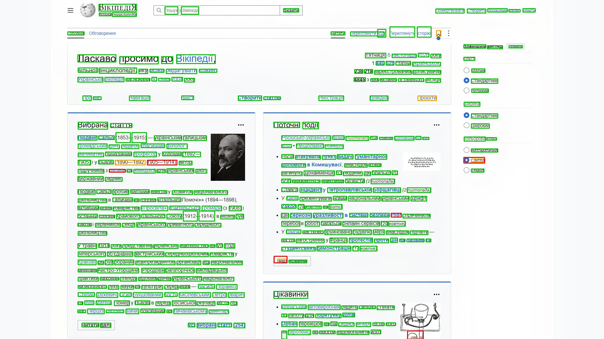 |
| *Відсутні S-колбочки (синій).* | *Зсув чутливості L-колбочок.* |

| Ахроматопсія (Скотопічна) |
|:---:|
| 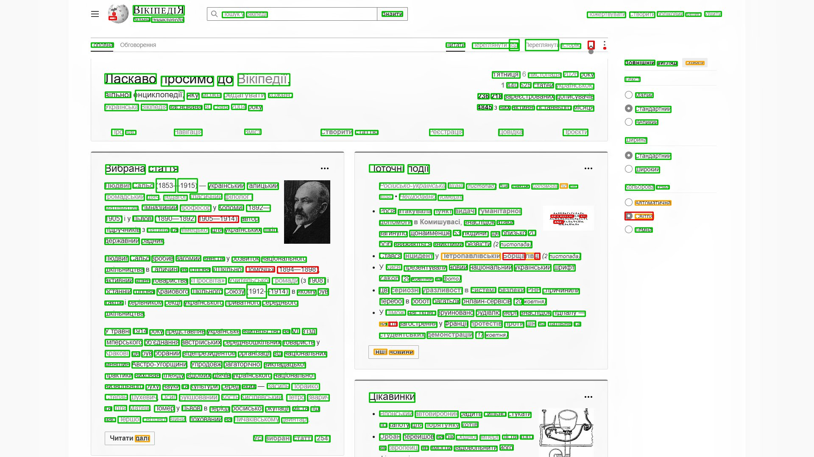 |
| *Лише паличковий (чорно-білий) зір.* |

---

### 📈 Прогін по шкалі тяжкості (`--sweep`)
ILR як функція тяжкості s для 9 моделей; помаранчева лінія — поріг деградації (5 %), червона — точка руйнування (50 %), верхня вісь — клінічні значення.

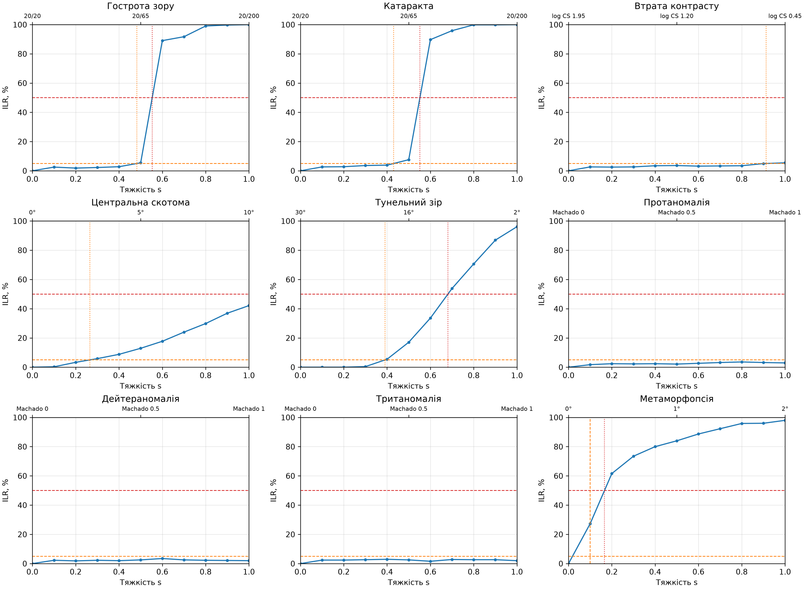

---

## 🛠️ Встановлення

### 1. Системні Залежності (Tesseract OCR)

Для роботи OCR необхідно встановити **Tesseract** у вашій ОС:

* **Windows:** Завантажте інсталятор з [UB Mannheim](https://github.com/UB-Mannheim/tesseract/wiki).
    * ⚠️ **Важливо:** Під час встановлення оберіть мови `Ukrainian` та `English`.
* **macOS:** `brew install tesseract tesseract-lang`
* **Linux:** `sudo apt-get install tesseract-ocr tesseract-ocr-ukr tesseract-ocr-eng`

### 2. Python Залежності

1.  Клонуйте репозиторій:
    ```bash
    git clone https://github.com/Glubin-yep/Accessibility_Simulator.git
    cd Accessibility_Simulator
    ```

2.  Створіть віртуальне середовище (рекомендовано):
    ```bash
    python -m venv venv
    # Windows:
    .\venv\Scripts\activate
    # macOS/Linux:
    source venv/bin/activate
    ```

3.  Встановіть бібліотеки:
    ```bash
    pip install -r requirements.txt
    ```

## 🚀 Використання

1.  Запустіть аналіз сторінки (без `--url` використовується `URL_TO_ANALYZE` з `config.py`):
    ```bash
    python main.py --url https://uk.wikipedia.org
    ```

2.  **Результат:**
    * Скрипт запустить Chrome у фоновому режимі (Selenium сам знайде або завантажить браузер і драйвер).
    * У консолі з'явиться прогрес виконання симуляцій.
    * Зображення з результатами та таблиця-звіт з'являться в папці `results/`.

### Приклади

```bash
# Знімки класичного розміру (Full HD, лише перший екран) — зручно вставляти в документ
python main.py --viewport 1920x1080 --viewport-only --output-dir results/doc_1080

# Кілька сторінок за один запуск
python main.py --url https://uk.wikipedia.org --url https://www.python.org

# Інша геометрія перегляду: ноутбук 14" (≈ 157 PPI, DPR 2) на відстані 50 см
python main.py --distance-cm 50 --ppi 157 --dpr 2

# Перевірка якості в CI: код виходу 1, якщо будь-яка симуляція втрачає > 30 % слів
python main.py --max-ilr 30

# Послідовне виконання для коректних замірів часу
python main.py --workers 1

# Прогін по шкалі тяжкості: пороги деградації для 9 моделей
python main.py --sweep

# Дрібніша сітка, власні пороги та PNG для кожної точки
python main.py --sweep --sweep-steps 20 --onset-ilr 10 --breaking-ilr 40 --save-sweep-images
```

### Параметри запуску

| Параметр | Опис |
|---|---|
| `--url URL` | Сторінка для аналізу. Можна вказати кілька разів — кожна отримає свою підпапку в `results/`. |
| `--output-dir DIR` | Папка для результатів (за замовчуванням `results`). |
| `--viewport WxH` | Розмір області перегляду, CSS px (за замовчуванням `2560x1440`; для документів — `1920x1080`). |
| `--viewport-only` | Знімати лише видиму частину сторінки (перший екран) замість усієї сторінки. |
| `--workers N` | Кількість паралельних потоків, ≥ 1 (за замовчуванням 4). `--workers 1` — послідовно, для коректних замірів часу. |
| `--max-ilr P` | Поріг якості: код виходу 1, якщо ILR будь-якої симуляції > P %. |
| `--tesseract_cmd PATH` | Шлях до `tesseract`, якщо його немає в `PATH`. |
| `--distance-cm D` | Відстань від очей до екрана, см (за замовчуванням 60). |
| `--ppi P` | Щільність пікселів екрана (за замовчуванням 109, 27" 2560×1440). |
| `--dpr R` | Device pixel ratio (за замовчуванням 1). |
| `--sweep` | Режим прогону по шкалі тяжкості (див. нижче). |
| `--sweep-steps N` | Кількість точок сітки, ≥ 2 (за замовчуванням 10). |
| `--onset-ilr P` | Поріг початку деградації, ILR % (за замовчуванням 5). |
| `--breaking-ilr P` | Точка руйнування, ILR % (за замовчуванням 50). |
| `--save-sweep-images` | Зберігати PNG для кожної точки шкали (лише з `--sweep`). |

Коди виходу: `0` — успішно, `1` — перевищено поріг `--max-ilr` (лише звичайний режим; у `--sweep` ігнорується), `2` — помилка (Tesseract, браузер, невдала модель у `--sweep` тощо).

## 📐 Геометрія перегляду та модель спостерігача

Тяжкість вади переводиться в кутові величини, тому програма знає, як далеко користувач сидить від екрана. Скріншот знімається з `deviceScaleFactor = 1`, тож 1 піксель зображення = 1 CSS-піксель фізичним розміром `25.4 · dpr / ppi` мм. Параметри: `--distance-cm` (60), `--ppi` (109), `--dpr` (1); висота фрагментів для моделей поля зору береться з `--viewport`.

За замовчуванням це ≈ 44.9 піксель/градус, тобто частота Найквіста екрана ≈ 22.4 цикл/град. Нормальний спостерігач має частоту зрізу 30 цикл/град (гострота 20/20), тож вона вища за Найквіста: легке зниження гостроти на такому екрані **майже не змінює** (екран сам не передає таких частот). Про це програма виводить довідку; це очікувана поведінка, а не помилка. Щоб побачити тонші ефекти, збільшіть `--distance-cm` або `--ppi`.

Спостерігач реалізує метод Peli (1990): зображення розкладається на смуги піраміди Лапласа, і в кожній смузі обнуляються піксели з локальним контрастом нижче порога `1/CSF(f)`. CSF — лог-парабола Lesmes et al. (2010), параметри якої задаються двома клінічними числами: гострота (logMAR) і контрастна чутливість (Pelli-Robson log CS). Еталон (оригінал) теж проходить через нормального спостерігача (logMAR 0.0, log CS 1.95).

## 📈 Режим `--sweep`: прогін по шкалі тяжкості

Замість набору фіксованих пресетів кожна вада прогоняється по шкалі тяжкості `s ∈ [0, 1]` (за замовчуванням 10 кроків: `s = 0.1 … 1.0`). Для кожної точки обчислюється ILR, після чого на кривій знаходяться два пороги (лінійна інтерполяція між сусідніми точками):

* **початок деградації** — перший перетин ILR ≥ 5 % (`--onset-ilr`);
* **точка руйнування** — перший перетин ILR ≥ 50 % (`--breaking-ilr`).

```bash
python main.py --sweep --url https://uk.wikipedia.org --output-dir results/sweep_run
python main.py --sweep --sweep-steps 20 --onset-ilr 10 --breaking-ilr 60 --save-sweep-images
python main.py --sweep --distance-cm 45 --ppi 160 --dpr 2   # інша геометрія перегляду
```

Результати в `<output-dir>/sweep/`:

| Файл | Вміст |
|---|---|
| `sweep.json` | Геометрія перегляду, розмір еталона, пороги, для кожної моделі — точки (s, клінічне значення, ILR, помилка) і знайдені пороги (ILR і пороги у частках 0..1). |
| `sweep_ilr.png` | Графік 3×3 (300 dpi): ILR(s) для кожної моделі, лінії порогів, маркери знайдених точок, друга вісь X — клінічні значення. |
| `images/` | PNG для кожної точки сітки, лише з `--save-sweep-images`. |

У консолі виводиться таблиця «Модель | Деградація | Руйнування»; якщо поріг не досягнуто, пишеться «> 1.0». Якщо поріг лежить уже в першому інтервалі сітки (0, s₁], він не виміряний, а лише обмежений зверху: у таблиці це «≤ 0.10 (≤ …)», у `sweep.json` — `"upper_bound": true`, на графіку — штрихова лінія в s₁. Після таблиці для моделей з помилковими точками виводиться перше повідомлення про помилку. Точки обчислюються паралельно (`--workers`, за замовчуванням 4: одна точка на великій сторінці займає 1-2 ГБ пам'яті). Помилка в окремій точці не зупиняє прогін; модель, у якої не вдалося більше половини точок, вважається невдалою (код виходу 2).

### Моделі та клінічні шкали

| Модель | Клінічне значення від s | Що моделюється |
|---|---|---|
| Гострота зору (`acuity`) | logMAR = s (s = 0.3 → 20/40, s = 1 → 20/200) | зниження гостроти в моделі спостерігача |
| Катаракта (`cataract`) | logMAR = s, log CS = 1.95 − 1.05·s | пожовтіння, засвітка, зниження гостроти і контрастної чутливості |
| Втрата контрасту (`contrast`) | log CS = 1.95 − 1.5·s | зниження контрастної чутливості |
| Центральна скотома (`scotoma`) | радіус = 10°·s | втрата центрального поля в кожному фрагменті висотою з viewport |
| Тунельний зір (`tunnel`) | s = 0: без обмеження; s > 0: радіус поля = 30° − 28°·s (s = 0.714 → 10°, критерій сліпоти за полем зору) | втрата периферії в кожному фрагменті |
| Протаномалія, дейтераномалія, тританомалія (`protanomaly`, `deuteranomaly`, `tritanomaly`) | severity Machado = s | аномальна трихромазія (Machado et al., 2009) |
| Метаморфопсія (`metamorphopsia`) | M-CHARTS ≈ 2°·s | синусоїдальне зміщення, амплітуда 2°·s, період 3° |

Ахроматопсія, дихромазії Brettel та флоатери не мають клінічної шкали (бінарні стани), тому в прогоні по шкалі не беруть участі.

## 🧪 Пресети звичайного прогону

Без `--sweep` програма виконує 15 пресетів; назва містить клінічне значення. Усі пресети застосовуються через нормального спостерігача з поточними `--distance-cm`/`--ppi`/`--dpr`.

| Назва | Модель, s |
|---|---|
| Гострота зору (20/40) | acuity, 0.3 |
| Гострота зору (20/100) | acuity, 0.7 |
| Катаракта (20/40) | cataract, 0.3 |
| Катаракта (20/100) | cataract, 0.7 |
| Втрата контрасту (log CS 1.20) | contrast, 0.5 |
| Центральна скотома (5°) | scotoma, 0.5 |
| Тунельний зір (10°) | tunnel, 0.714 |
| Протаномалія (Machado 0.6) | protanomaly, 0.6 |
| Метаморфопсія (0.5°) | metamorphopsia, 0.25 |
| Метаморфопсія (1.5°) | metamorphopsia, 0.75 |
| Ахроматопсія (Скотопічна) | фіксована симуляція |
| Протанопія (Brettel) | фіксована симуляція |
| Дейтеранопія (Brettel) | фіксована симуляція |
| Тританопія (Brettel) | фіксована симуляція |
| Флоатери (Діабет. рет.) | фіксована симуляція (seed 42) |

## ⚠️ Обмеження

* **Втрата поля зору — оцінка за одну фіксацію.** Сторінка ріжеться на фрагменти висотою з viewport, і погляд фіксується в центрі кожного. Реальний користувач рухає очима, тому ILR для скотоми й тунельного зору — оцінка зверху втрати за одну фіксацію, а не неможливість прочитати.
* **OCR як модель читача.** Пороги CSF моделюють виявлення, а не розпізнавання літер; Tesseract не замінює дослідження з людьми. Калібрувальний тест перевіряє узгодженість моделі гостроти з таблицею, але не є клінічною валідацією.
* **Октавне квантування порогів.** Спостерігач обробляє смуги піраміди Лапласа шириною в октаву, а чутливість для кожної смуги береться на її нижньому краю (f/√2). Тому пороги гостроти, катаракти й контрасту змінюються сходинками, а їхнє положення трохи залежить від геометрії перегляду (`--distance-cm`, `--ppi`). Дві цифри після коми в порогах — це результат інтерполяції, а не реальна роздільність моделі.
* **Наближена клінічна шкала метаморфопсії.** Зв'язок M-CHARTS → амплітуда синусоїди є припущенням моделі.
* **Параметри катаракти** (коефіцієнти пожовтіння і засвітки) — параметри моделі, а не клінічні вимірювання.
* Ахроматопсія, дихромазії та флоатери не мають клінічної шкали і порівнюються лише у звичайному прогоні.

### Тести

```bash
pip install -r requirements-dev.txt
python -m pytest
```

Більшість тестів не потребує Tesseract чи Chrome. Калібрувальний тест (`tests/test_calibration.py`, маркер `tesseract`) перевіряє модель гостроти за синтетичною таблицею й потребує Tesseract (ukr+eng); без нього він пропускається. Тест перевіряє нормальний зір і logMAR 0.3 та 0.6: рядки, грубіші за межу на 0.1 logMAR, мають читатися, а дрібніші на 0.1 — ні. Щоб виключити такі тести явно:

```bash
python -m pytest -m "not tesseract"
```

### Налаштування шляху до Tesseract (Windows)

Програма шукає Tesseract у `PATH`, а потім у `C:\Program Files\Tesseract-OCR\`. Якщо він встановлений в іншу папку, вкажіть шлях вручну:

```bash
python main.py --tesseract_cmd "D:\Apps\Tesseract-OCR\tesseract.exe"
